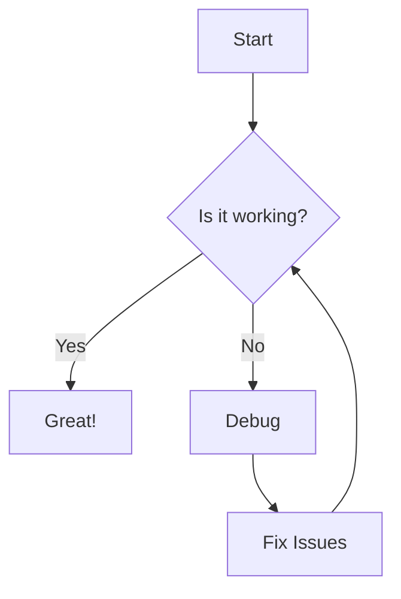
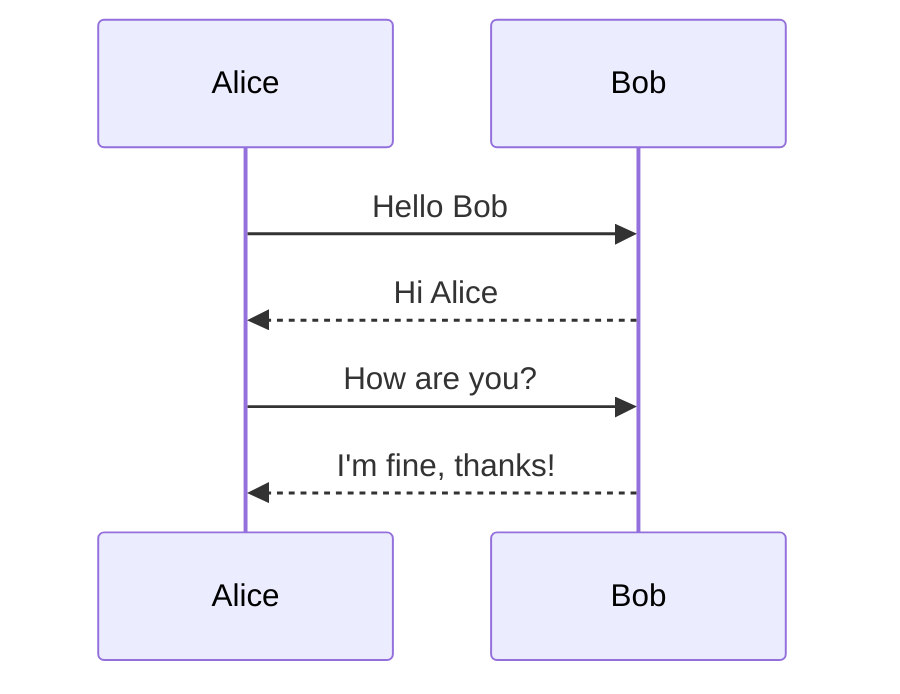

# Markdown Rendering Test Suite

This document tests **every** Markdown feature your agent harness might render.

---

## 1. Headings

# H1 Heading
## H2 Heading
### H3 Heading
#### H4 Heading
##### H5 Heading
###### H6 Heading

---

## 2. Paragraphs & Text Formatting

This is a normal paragraph. It can contain **bold text**, *italic text*, ***bold and italic***, and ~~strikethrough~~.

You can also use __underscore bold__ and _underscore italic_.

Inline `code` uses backticks.

Superscript: x^2^ (GitHub Flavored Markdown doesn't support this, but some renderers do)

Subscript: H~2~O (same caveat)

==Highlighted text== (Mark syntax, supported by some renderers)

Keyboard input: <kbd>Ctrl</kbd> + <kbd>C</kbd>

---

## 3. Links

[Basic link](https://example.com)

[Link with title](https://example.com "Example Title")

[Reference-style link][ref1]

[ref1]: https://example.com "Reference title"

Autolink: <https://example.com>

Email: <mailto:test@example.com>

---

## 4. Images


![Alt text with reference][img-ref]

[img-ref]: https://via.placeholder.com/150 "Referenced image"

---

## 5. Blockquotes

> This is a blockquote.
> It can span multiple lines.

> Nested blockquotes:
>> This is a nested quote.
>>> And another level deep.

> Blockquotes can contain **formatting** and `code`.

> > Nested with space.

---

## 6. Lists

### Unordered Lists

- Item 1
- Item 2
  - Nested item 2.1
  - Nested item 2.2
    - Deep nested 2.2.1
- Item 3

* Asterisk item
* Another asterisk

+ Plus item
+ Another plus

### Ordered Lists

1. First item
2. Second item
   1. Nested ordered 2.1
   2. Nested ordered 2.2
      1. Deep nested 2.2.1
3. Third item

### Mixed Lists

1. Ordered item
   - Unordered sub-item
   - Another sub-item
      1. Ordered sub-sub-item
      2. Another one
2. Back to ordered

### Task Lists

- [x] Completed task
- [ ] Incomplete task
- [ ] Another incomplete task
  - [x] Nested completed task
  - [ ] Nested incomplete task

---

## 7. Code Blocks

### Fenced Code Block (no language)

```
This is a plain code block.
No syntax highlighting here.
```

### Fenced Code Block with Language

```python
def hello_world():
    """A simple function."""
    print("Hello, World!")
    return 42

class MyClass:
    def __init__(self):
        self.value = 0
```

```javascript
function greet(name) {
    console.log(`Hello, ${name}!`);
    return {
        message: "Greeting sent",
        timestamp: Date.now()
    };
}
```

```json
{
    "name": "test",
    "version": "1.0.0",
    "dependencies": {
        "markdown": "^5.0.0"
    }
}
```

```sql
SELECT id, name, email
FROM users
WHERE active = true
ORDER BY created_at DESC
LIMIT 10;
```

```bash
#!/bin/bash
echo "Hello World"
for i in {1..5}; do
    echo "Iteration $i"
done
```

```diff
- removed line
+ added line
  unchanged line
```

### Indented Code Block

    This is an indented code block.
    It uses 4 spaces of indentation.
    No backticks needed.

---

## 8. Horizontal Rules

---

***

___

- - -

* * *

---

## 9. Tables

### Basic Table

| Header 1 | Header 2 | Header 3 |
|----------|----------|----------|
| Cell 1   | Cell 2   | Cell 3   |
| Cell 4   | Cell 5   | Cell 6   |

### Aligned Table

| Left | Center | Right |
|:-----|:------:|------:|
| L1   | C1     | R1    |
| L2   | C2     | R2    |
| L3   | C3     | R3    |

### Table with Formatting

| Feature | Status | Notes |
|:--------|:------:|------:|
| Bold | **Active** | Working well |
| Code | `stable` | v1.2.3 |
| Links | [docs](https://example.com) | See reference |

---

## 10. Footnotes

Here's a sentence with a footnote.[^1]

[^1]: This is the footnote content.

Multiple footnotes in one paragraph.[^2] And another one.[^3]

[^2]: First footnote text.
[^3]: Second footnote text with multiple lines.
    Indent to add more paragraphs to the footnote.

---

## 11. Definition Lists

Term 1
: Definition for term 1

Term 2
: Definition for term 2
: Another definition for term 2

Term 3
: Definition with **formatting** and `code`.

---

## 12. HTML in Markdown

<div align="center">

**Centered content with HTML**

</div>

<details>
<summary>Click to expand</summary>

This content is hidden by default.

- Item 1
- Item 2

</details>

<span style="color: red;">Red text (if supported)</span>

<kbd>Ctrl</kbd> + <kbd>Alt</kbd> + <kbd>Del</kbd>

---

## 13. Math / LaTeX

Inline math: $E = mc^2$

Block math:

$$
\int_{-\infty}^{\infty} e^{-x^2} dx = \sqrt{\pi}
$$

Aligned equations:

$$
\begin{align}
a &= b + c \\
d &= e + f
\end{align}
$$

---

## 14. Diagrams (Mermaid)





---

## 15. Emoji

:smile: :rocket: :thumbsup: :star: :fire: :heart:

Unicode: 🎉 🚀 💻 🔥 ✅ ❌

---

## 16. Escaping Characters

\* Not italic \*
\` Not code \`
\[ Not a link \]
\# Not a heading
\> Not a quote

---

## 17. Line Breaks

Line 1  
Line 2 (two spaces at end)

Line 3<br>Line 4 (using HTML br)

---

## 18. Comments

<!-- This is an HTML comment and should not be rendered -->

---

## 19. Abbreviations

The HTML specification is maintained by the W3C.

*[HTML]: Hyper Text Markup Language
*[W3C]: World Wide Web Consortium

---

## 20. Complex Nested Example

> ### Heading in a Blockquote
>
> - List item in quote
>   - Nested list
> - Another item with `code`
>
> ```python
> # Code block in quote
> def quoted():
>     return "nested"
> ```
>
> | Table | In | Quote |
> |-------|-----|-------|
> | Yes   | It | Works |

---

## 21. Anchor Links

[Jump to Headings](#1-headings)

[Jump to Tables](#9-tables)

---

## 22. Empty Elements


Multiple blank lines above should collapse.

---

## 23. Special Characters

Currency: $100, €50, £30, ¥5000

Arrows: → ← ↑ ↓ ↔ ↕ ⇒ ⇐ ⇑ ⇓

Math: ± × ÷ √ ∞ ≈ ≠ ≤ ≥

Boxes: □ ■ ▪ ▫

Cards: ♠ ♥ ♦ ♣

Chess: ♔ ♕ ♖ ♗ ♘ ♙

Music: ♩ ♪ ♫ ♬

Weather: ☀ ☁ ☂ ☃

---

## 24. Very Long Lines (Word Wrap Test)

ThisIsAVeryLongWordThatShouldProbablyBeBrokenOrWrappedByTheRendererDependingOnHowItHandlesOverflowAndWordBreakingInMarkdownContentRenderingSystems.

---

## 25. Mixed Content Block

**Bold paragraph** followed immediately by:

```code
Code block
```

> Quote

- List

| Table |
|-------|
| Data  |

---

*End of comprehensive Markdown test suite.*
