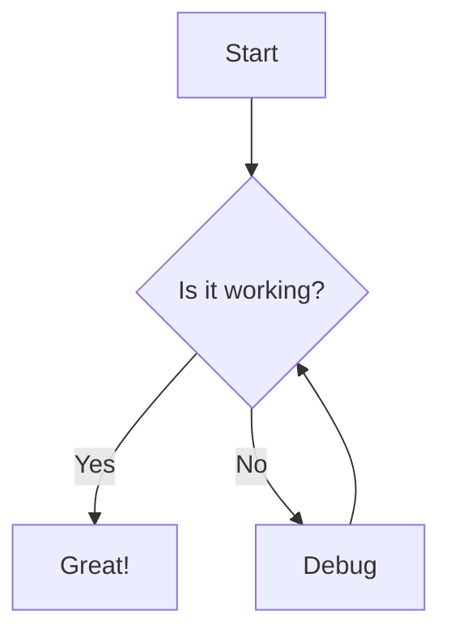

# Markdown Rendering Test Suite

> **Note:** This document exercises every major Markdown feature.

---

## 1. Headings

# H1 Heading
## H2 Heading
### H3 Heading
#### H4 Heading
##### H5 Heading
###### H6 Heading

---

## 2. Paragraphs & Text Formatting

This is a normal paragraph with **bold text**, *italic text*, and ***bold italic text***.

You can also use __underscore bold__, _underscore italic_, and ___underscore bold italic___.

~~Strikethrough text~~ and `inline code`.

Superscript: x^2^ (GitHub Flavored Markdown may not render this).
Subscript: H~2~O (same caveat).

---

## 3. Links

[Inline link](https://example.com)

[Link with title](https://example.com "Example Title")

Autolink: <https://example.com>

Reference-style link: [Example][ref]

[ref]: https://example.com "Reference Title"

---

## 4. Images


![Alt text][img-ref]

[img-ref]: https://via.placeholder.com/150 "Reference Image"

---

## 5. Blockquotes

> This is a blockquote.
>
> It can span multiple paragraphs.

> Nested blockquote:
>> This is nested.
>>> This is deeply nested.

> Blockquote with **formatting** and `code`.

---

## 6. Lists

### Unordered Lists

- Item 1
- Item 2
  - Nested item 2.1
  - Nested item 2.2
    - Deeply nested 2.2.1
- Item 3

* Asterisk item
* Another asterisk item

+ Plus item
+ Another plus item

### Ordered Lists

1. First item
2. Second item
   1. Nested ordered 2.1
   2. Nested ordered 2.2
3. Third item

### Mixed Lists

1. Ordered item
   - Unordered sub-item
   - Another unordered sub-item
2. Another ordered item
   1. Ordered sub-item
   2. Another ordered sub-item

### Task Lists

- [x] Completed task
- [ ] Incomplete task
- [ ] Another incomplete task
  - [x] Nested completed task
  - [ ] Nested incomplete task

---

## 7. Code

### Inline Code

Use `npm install` to install packages.

### Fenced Code Blocks

```javascript
function greet(name) {
  console.log(`Hello, ${name}!`);
  return true;
}
```

```python
def fibonacci(n):
    if n <= 1:
        return n
    return fibonacci(n-1) + fibonacci(n-2)
```

```bash
#!/bin/bash
echo "Hello, World!"
ls -la
git status
```

```diff
+ Added line
- Removed line
  Unchanged line
```

```json
{
  "name": "test",
  "version": "1.0.0",
  "dependencies": {
    "markdown": "^1.0.0"
  }
}
```

### Code Block with Line Numbers (if supported)

```javascript {linenos=table,hl_lines=[2,3],linenostart=1}
const x = 1;
const y = 2;  // highlighted
const z = 3;  // highlighted
console.log(x + y + z);
```

---

## 8. Horizontal Rules

---

***

___

- - -

* * *

---

## 9. Tables

### Basic Table

| Header 1 | Header 2 | Header 3 |
|----------|----------|----------|
| Cell 1   | Cell 2   | Cell 3   |
| Cell 4   | Cell 5   | Cell 6   |

### Aligned Table

| Left-aligned | Center-aligned | Right-aligned |
|:-------------|:--------------:|--------------:|
| Left         | Center         | Right         |
| L            | C              | R             |

### Table with Formatting

| Feature | Status | Notes |
|---------|--------|-------|
| **Bold** | ✅ Working | *Italic note* |
| `Code` | ✅ Working | ~~Deprecated~~ |
| [Link](https://example.com) | ✅ Working | See docs |

---

## 10. HTML Elements

<details>
<summary>Click to expand</summary>

Hidden content inside a details/summary block.

```python
print("Hello from inside details!")
```

</details>

<kbd>Ctrl</kbd> + <kbd>C</kbd> to copy.

Some <mark>highlighted</mark> text (if supported).

---

## 11. Footnotes

Here is some text with a footnote.[^1]

[^1]: This is the footnote content.

Another footnote reference.[^2]

[^2]: Another footnote with **formatting**.

---

## 12. Definition Lists

Term 1
: Definition 1

Term 2
: Definition 2a
: Definition 2b

---

## 13. Emoji (if supported)

:smile: :rocket: :fire: :bug: :white_check_mark:

---

## 14. Math / LaTeX (if supported)

Inline math: $E = mc^2$

Block math:

$$
\int_{-\infty}^{\infty} e^{-x^2} dx = \sqrt{\pi}
$$

$$
\begin{bmatrix}
a & b \\
c & d
\end{bmatrix}
$$

---

## 15. Diagrams (Mermaid - if supported)



---

## 16. Alerts / Admonitions (GitHub-style)

> [!NOTE]
> This is a note.

> [!TIP]
> This is a tip.

> [!IMPORTANT]
> This is important.

> [!WARNING]
> This is a warning.

> [!CAUTION]
> This is a caution.

---

## 17. Escaped Characters

\* Not italic \*
\# Not a heading
\[ Not a link \]
\` Not code \`

---

## 18. Complex Nested Example

> ### Heading inside blockquote
>
> > Nested quote with a list:
> > - Item 1 with `code`
> > - Item 2 with [a link](https://example.com)
> >
> > ```python
> > def nested():
> >     return "works"
> > ```

1. Ordered item with **bold** and a table:
   | A | B |
   |---|---|
   | 1 | 2 |
2. Another item with a blockquote:
   > Quoted text
3. Final item with code:
   ```javascript
   const x = 42;
   ```

---

*End of test document.*
